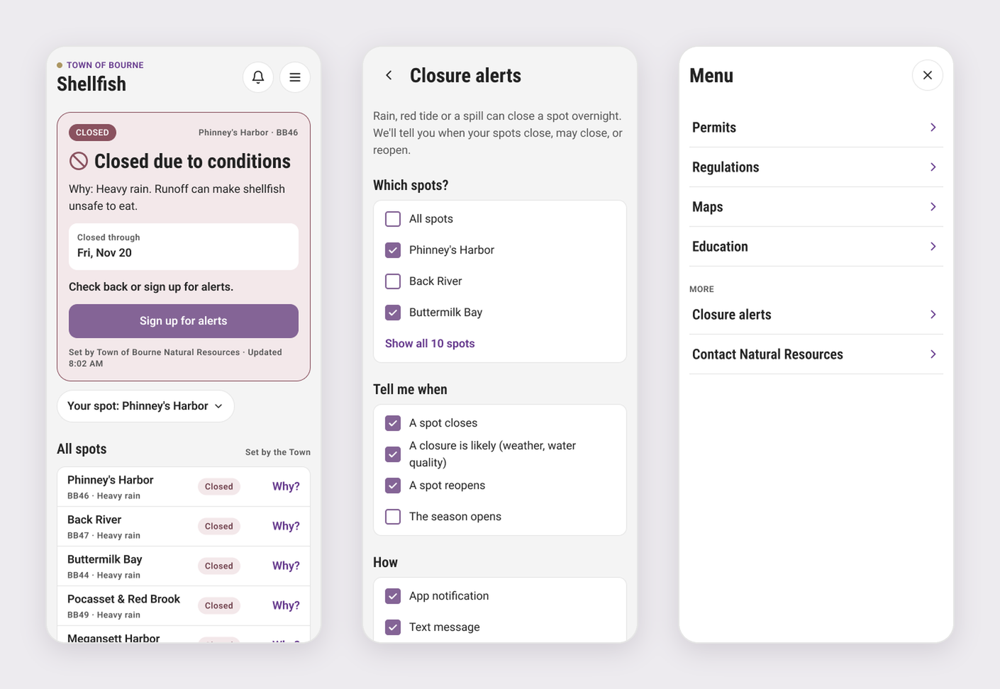
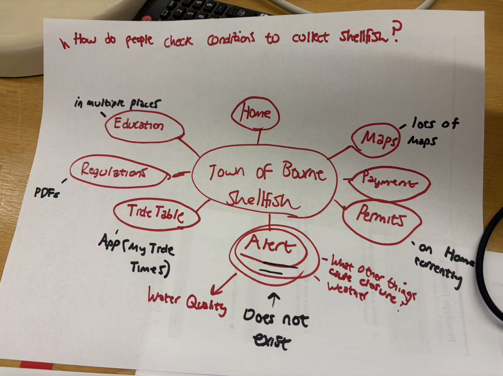
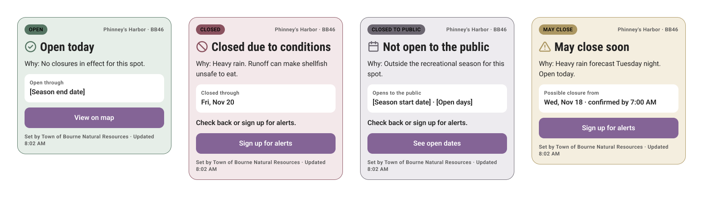
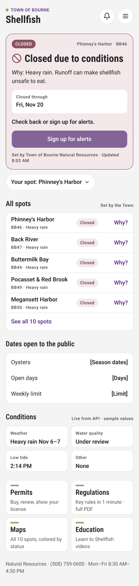
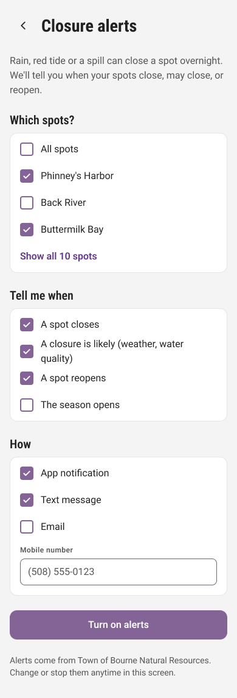
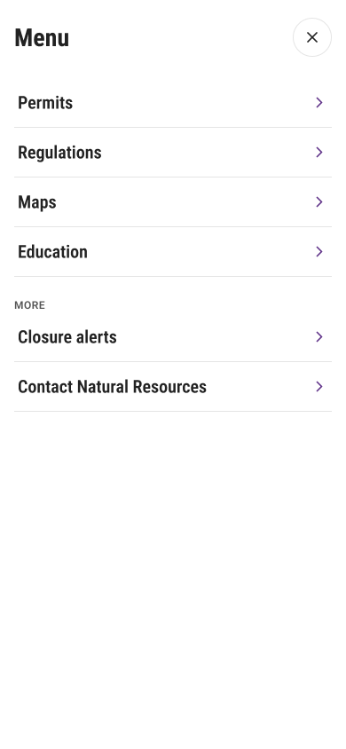
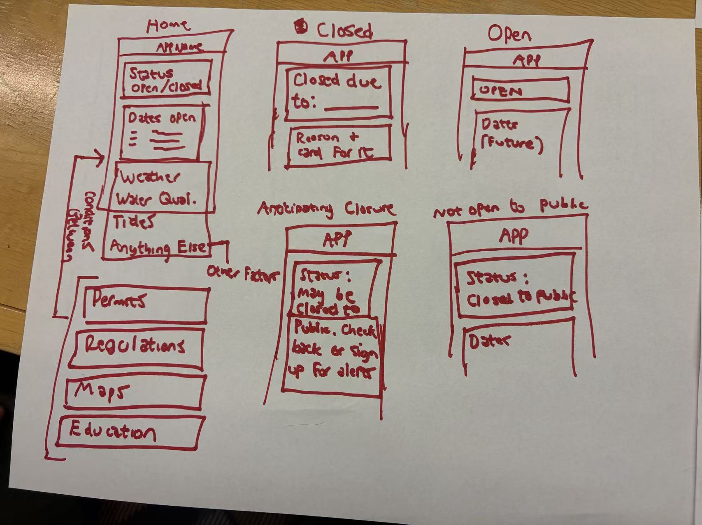
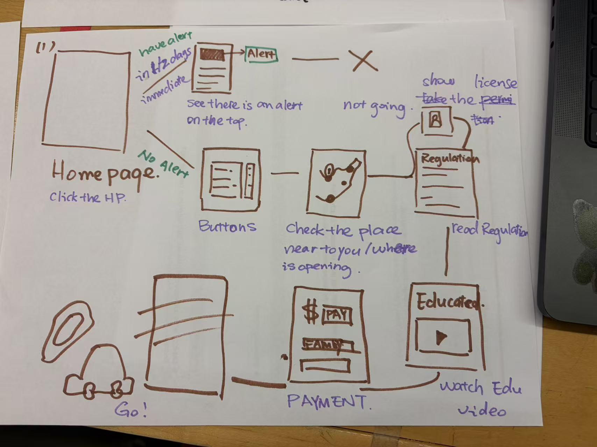

# Bourne Shellfish

An app concept for the Town of Bourne, MA that tells people whether their shellfishing spot is open before they get in the car. Hello World, week 9 (Assignment 2), by Yiran and Caitlin.

**[Open the design in Figma →](https://www.figma.com/design/0c7xevsdlg0ijGucKJmcR7/Bourne-Shellfish-App-%E2%80%94-Status-Card?node-id=0-1)**

## The problem

Right now, everything a shellfisher needs is scattered across the Town website. Regulations are PDFs, there are lots of separate maps, education lives in several places, tide tables are in a separate app, and permits sit on the home page. There's no alert system at all, so the only way to know a spot is closed for heavy rain or a failed water sample is to find it yourself, sometimes after you've already driven to the water.

## What the app answers

Open the app and know right away:

1. **Can I go today?** Is my spot open, closed, not open to the public, or likely to close soon?
2. **Why?** Weather, water quality, red tide, season, or another cause.
3. **When?** "Closed through Fri, Nov 20", never "until the Town reopens it".
4. **What next?** Check back, see the dates, or sign up for alerts.

## The status card

The whole design is built around one component. Every state answers the same five things in the same place: the state (as a word, a color and an icon, never color alone), the reason, the date, the next step, and who set it and when.

When two states apply, the card shows the one that stops you going now and adds the other as one line, for example Closed (heavy rain) plus "Also out of season until [date]". A closed spot never shows directions.

## Screens

The bell, the button on the status card and the menu all lead to the alert sign-up, so it's always one tap away.

| Home (Closed) | Closure alerts | Menu |
|---|---|---|
|  |  |  |

## Design system

Everything is built with Figma Variables, so changing a value updates every screen.

- **Color:** taken from the real Town of Bourne website (purple #846496, deep purple #63368B, mauve, khaki gold, sage). Status cards use soft tints with a thin border, and only the chip and icon carry the strong color.
- **Type:** Roboto Condensed for headings and Roboto for body, the same fonts the Town site uses. Seven text styles are bound to the type variables.
- **Grid:** 4 px base, 390 px frame with a 4-column grid, 16 px margins and gutters.
- **Components:** Status card, Spot row, Button, Stat tile, Section tile, Checkbox row, Menu item.
- **Accessibility:** 44 px minimum touch targets and at least 4.5:1 text contrast.

## Sketches

| Wireframes | User flow |
|---|---|
|  |  |

## Process files

- [brief.md](brief.md): the question, who it's for, and the one result we want
- [rules.md](rules.md): what must stay, what may change, and what must never happen
- [notes.md](notes.md): the request log, our context comparison, the rule check and the classmate test

## How we worked

We designed this with Claude (with the Figma connector). We wrote the brief and rules, sketched the flows and wireframes, and made the decisions on every result. Claude asked the clarifying questions, built the variables, components and screens in Figma, and read the Town site's real colors and fonts. The biggest lesson is in [notes.md](notes.md#2-checked-comparison-one-context-change): "use the Town's colors" in words wasn't enough, and the design only matched once we gave it the actual website.
